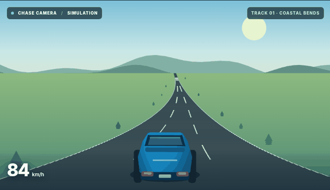

# RoadSense — steering prediction lab



**NEW: the default GitHub Pages homepage is a moving-car driving simulation**, not a static video or code-only page. Open [`docs/index.html`](docs/index.html) in a browser or publish the `/docs` folder on GitHub Pages to see the car moving, route/speed controls, live steering telemetry, and a button to switch to the existing computer-vision replay.

The animated driving scene is a **JavaScript Canvas simulation with a simple route-following controller**, not a trained CNN. The separate recorded video demonstrates OpenCV baseline results from synthetic footage. The optional PyTorch/ONNX pipeline below can be trained separately; the static GitHub Pages website does **not** execute Python inference.

**To publish on your own GitHub account without forking**, see **[PUBLISH_ON_GITHUB.md](PUBLISH_ON_GITHUB.md)** for exact commands and Pages configuration.


A new, **AI-assisted educational starter implementation** of a camera-to-steering-angle project, created without forking or copying the source files of the cited reference repository. The initial project files were generated with ChatGPT for the repository owner's requested demonstration. This does **not** mean the owner personally wrote every line. Read [AI_USE_AND_PROVENANCE.md](AI_USE_AND_PROVENANCE.md) before using the project for any academic assessment.

The project includes:

- **PyTorch CNN** training for steering-angle regression.
- **ONNX Runtime** inference for small, CPU-friendly deployments.
- **Gradio UI** with live **browser webcam streaming**, image uploads, and capped video replay.
- **Lane geometry baseline** that works before training, explicitly labelled **non-ML**.
- **Sample demo** processed from 160 original synthetic road frames, preloaded into the UI.
- **GitHub Pages HTML showcase** featuring a playable recording and interactive scrubbing.
- Chronological train/validation/test splits, a frame gap, and held-out MAE/RMSE reporting.

> **SAFETY**: This is a visual research demonstration. **Never** connect it to steering,
> braking, throttle, or a real vehicle. Accuracy on collected frames does not
> establish safety or real-world driving competence.

## 1. Quick start — see a working demo without model training

Requires Python 3.10+ (Python 3.11 is a practical choice).

```bash
python -m venv .venv
# Windows PowerShell:
.venv\Scripts\Activate.ps1
# macOS / Linux instead:
# source .venv/bin/activate
pip install -r requirements.txt
python app.py
```

Open the local URL shown in your terminal (normally `http://127.0.0.1:7860`).
Choose **Lane geometry (untrained illustration)**; use the webcam or upload an image.
The page opens with **preloaded synthetic images and an eight-second processed video**.
You can also use the webcam or upload your own image or video. The heuristic uses visible
line geometry and can fail on curves, shadows, and unclear lanes. This does **not** demonstrate machine-learning quality.

To create a temporary publicly reachable demo URL for testing, set the following
**only if you intend to expose your app**:

- macOS/Linux: `GRADIO_SHARE=1 python app.py`
- PowerShell: `$env:GRADIO_SHARE="1"; python app.py`

That Gradio share URL is temporary, not a permanent hosted deployment.

## Browser-only showcase (GitHub Pages)

The `docs/` folder includes a polished animated car simulator at `index.html`,
with a separate `vision-replay.html` recording of OpenCV baseline results and
an interactive time scrubber. No external dependencies
are needed to view it. You can open `docs/index.html` directly in your browser.
The animated car is a **visual simulation**, not machine-learning inference.
The vision replay is **playback of computed results**, NOT live browser inference. For webcam,
image uploads or video uploads with fresh processing, use the Python Gradio app.

To publish the animated simulator for free from your own new GitHub repository: in the
repository select **Settings → Pages → Deploy from a branch → main → /docs**.
GitHub Pages will provide a static HTTPS website. Python Gradio must be hosted
separately if you want visitors to submit their own road footage for analysis.

## 2. Obtain the driving dataset

Download **Dataset 1** from Sully Chen's [driving-datasets](https://github.com/SullyChen/driving-datasets)
repository. Check the dataset's terms and source before using or redistributing it.
Unzip it **locally** so your project looks like:

```
road-sense/
├── app.py
├── train.py
├── requirements.txt
├── requirements-train.txt
├── src/
│   ├── data.py
│   ├── network.py
│   └── vision.py
├── data/
│   └── driving_dataset/
│       ├── data.txt
│       ├── 0.jpg
│       ├── 1.jpg
│       └── ...
└── models/
```

Each `data.txt` line has a filename and **angle in degrees**: `0.jpg 1.5`.
The reader also understands newer dataset angle-plus-timestamp entries.
The original dataset is not included in this repository and `data/` is ignored by Git.

## 3. Train **your own** model

```bash
pip install -r requirements-train.txt
python train.py --data data/driving_dataset --epochs 12 --batch-size 32
```

Training will:

1. Load your image/angle data, cropping the lower 150 pixels and resizing to 200 × 66.
2. Separate records chronologically into 70% training, 15% validation and 15% test;
   a configurable frame gap separates the sets.
3. Train a small CNN using supervised regression.
4. Select the checkpoint with the lowest validation MAE.
5. Print held-out MAE and RMSE in degrees; write `models/metrics.json`.
6. Save `models/steering.pt` and **export** `models/steering.onnx`.

For a machine without a GPU, training on many images can be slow. GPU training
is supported when a compatible PyTorch CUDA installation is available (not guaranteed
by the generic requirements file). You may train elsewhere and copy the ONNX file
back into `models/`.

**Important limitations:** Adjacent camera frames are correlated. The temporal split
reduces easy leakage, but one split, one route and MAE alone do not establish robust
generalisation. Check model errors by turns, road types, light, weather and camera
position. Test only on permitted offline recordings and simulated inputs.

## 4. Switch to your neural network

```bash
python app.py
```

Select **CNN steering prediction (trained model)**. Webcam frames, images and
video are then processed using your exported ONNX model.

**No trained ONNX model = no CNN predictions.** The app will say so explicitly;
it does not generate fictitious neural-network scores.

## 5. Create your *own* GitHub repository (no fork)

Create a **new, empty** GitHub repository named e.g. `RoadSense-Steering-AI`.
Use your chosen GitHub username in the remote URL:

```bash
git init
git branch -M main
git add .
git commit -m "Add AI-assisted RoadSense starter and project documentation"
git remote add origin https://github.com/YOUR-USERNAME/RoadSense-Steering-AI.git
git push -u origin main
```

If you already created a README or licence on GitHub, either create a truly empty
remote instead, or pull and resolve the remote history before your first push.

After the model is trained, `models/steering.onnx` is a regular tracked file
(unless you exclude it yourself). Check file size before pushing; GitHub's normal
file limits apply. Do not commit the dataset, unnecessary video files or API keys.

## 6. Put it online

**GitHub alone stores the source; GitHub Pages cannot run this Python inference
backend.** There are two separate steps: push the code to GitHub, then deploy a
service that executes `app.py`.

**Simple temporary demo:** `GRADIO_SHARE=1 python app.py`. Your laptop must remain
on, and the share URL is not permanent.

**Option A — Render (has a free instance):** Sign in to [Render](https://dashboard.render.com/),
choose **New → Web Service**, connect your **own GitHub repo**, and choose the
free instance if offered. The included `render.yaml` configures the service.
Otherwise, supply **Build Command** `pip install -r requirements.txt` and
**Start Command** `python app.py`. The app binds to the Render-assigned `PORT`.
Once deployed, Render provides a public `*.onrender.com` URL. The free instance
has **512 MB RAM** and can sleep after 15 minutes of inactivity; this app's
memory footprint and webcam support must be verified on your specific instance.
If it exceeds that memory budget, use a paid instance or a lighter deployment.
[Render free-tier limitations](https://render.com/docs/free).

**Option B — persistent Hugging Face Gradio app:** [Hugging Face Spaces](https://huggingface.co/docs/hub/spaces-overview)
can host a Gradio application. **As of November 2026, new compute-backed Gradio
Spaces require a paid eligible account** (check current account and pricing).
Deploy with [Gradio's `gradio deploy` command](https://www.gradio.app/guides/sharing-your-app)
or follow the Spaces new-repository workflow. The service will need your `app.py`,
`src/`, `requirements.txt` and trained `models/steering.onnx`.

You may also use another compatible Python web host; check whether the host
permits camera streaming, ffmpeg/video, and sufficient inference memory.

## 7. What is new and what should be credited?

The initial Python application, preprocessing, model training, and visualisation code in this starter were produced with ChatGPT assistance. It is **not a GitHub fork** of the referenced project, but the initial code should **not** be represented as personally written from scratch by a student who did not write it. Document subsequent changes, experiments, and understanding honestly in [DEVELOPMENT_RECORD.md](DEVELOPMENT_RECORD.md). The underlying idea of end-to-end steering prediction
is established research, not a new invention. Credit research and dataset sources:

- Bojarski et al. (2016), [End to End Learning for Self-Driving Cars](https://arxiv.org/abs/1604.07316).
- [Sully Chen — driving datasets](https://github.com/SullyChen/driving-datasets).
- [Aditya Gupta — Self-Driving-Car-](https://github.com/adityaguptai/Self-Driving-Car-) (reference project that motivated the independent build; no source files copied).

The reference repository has an MIT licence, but no source files from it are
incorporated here. If you later copy any of its code, preserve the required
copyright and permission notices. Add **your own** licence once you choose its
terms; the user of this starter is responsible for checking any chosen data,
assets, and models before redistribution.

## 8. Roadmap

- Add a numerical ground-truth comparison dashboard.
- Train on additional approved datasets and report per-domain metrics.
- Add uncertainty / out-of-distribution warnings.
- Record a short example video of the model operating on offline footage.
- Use a driving simulator to examine closed-loop behaviour (not a real vehicle).
